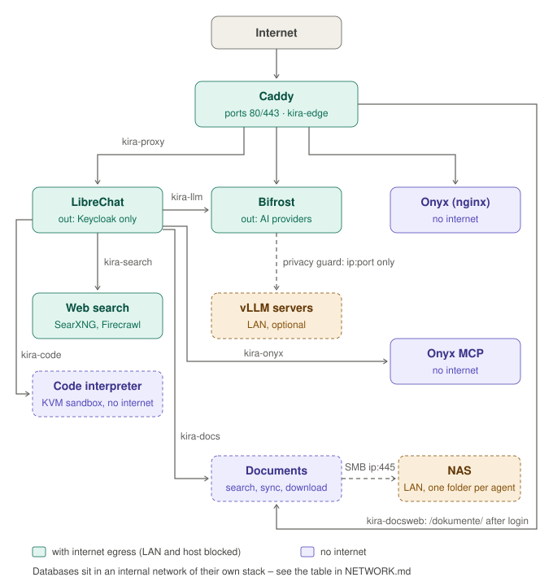

# KIRA – networks and containers

Which container is attached to which Docker network. Source of truth: the `compose.yml` files of the stacks and
`setup.sh` (creates the shared networks). Subnets in [README.md](README.md#connections-and-networks).

## Rules

- **Only Caddy publishes ports** on the host: 80, 443 and `127.0.0.1:8080` (Bifrost UI via SSH tunnel). Every other
  service is reachable only through Caddy and `kira-proxy`.
- **Databases have no internet.** They sit only in the internal network of their own stack (`*_backend`); one
  stack cannot reach the database of another.
- **Each shared network has one purpose:** `kira-llm` → Bifrost, `kira-search` → web search, `kira-onyx` → Onyx MCP,
  `kira-code` → code interpreter API, `kira-proxy` → Caddy to the web front ends. LibreChat is the only container in
  all of them.
- **Internet only where needed**, each stack through its own egress network (`172.31.60–64.0/24`). The LAN block
  (`kira-egress-firewall`) drops traffic from these networks to the LAN and to the host.
- **LibreChat has no internet** when Keycloak is in the LAN (`KEYCLOAK_INTERNAL_IP` set, or its name resolves to a
  private address) and the LAN block is on: from `kira-outbound` only Keycloak:443 and DNS are allowed. With Keycloak
  only via the internet, LibreChat gets internet like the other stacks.
  AI, web search and intranet always run over the internal networks.
- **Only LibreChat and Onyx reach Keycloak** in the LAN (login; Onyx for optional SSO in its admin area) – Bifrost and
  the web search do not. `builder-sync.py` runs on the host and is not affected.

## Container × network

✔ = attached. "Internet" = the egress network of the stack (`kira-edge`, `kira-outbound`, `bifrost-outbound`,
`websearch-outbound`, `onyx-outbound`). "Stack internal" = `kira_backend`, `bifrost_backend`, `websearch_backend`,
`onyx_backend`, `codeinterpreter_backend`. All networks except the egress networks are `internal` (no internet).

| Stack | Container | Internet | kira-proxy | kira-llm | kira-search | kira-onyx | kira-code | Stack internal |
|---|---|:-:|:-:|:-:|:-:|:-:|:-:|:-:|
| caddy | `caddy` | ✔ | ✔ (.2) | | | | | |
| kira | `librechat` | ✔ (only Keycloak:443 + DNS) | ✔ | ✔ | ✔ | ✔ | ✔ | ✔ |
| kira | `librechat-mongodb` | | | | | | | ✔ |
| kira | `librechat-meilisearch` | | | | | | | ✔ |
| kira | `librechat-rag` | | | ✔ | | | | ✔ |
| kira | `librechat-vectordb` | | | | | | | ✔ |
| bifrost | `bifrost` | ✔ (AI providers) | ✔ | ✔ | | | | ✔ |
| bifrost | `bifrost-db` | | | | | | | ✔ |
| websearch | `searxng` | ✔ | | | ✔ | | | |
| websearch | `firecrawl` | ✔ | | | ✔ | | | ✔ |
| websearch | `firecrawl-playwright` | ✔ | | | | | | ✔ |
| websearch | `firecrawl-redis` | | | | | | | ✔ |
| websearch | `firecrawl-rabbitmq` | | | | | | | ✔ |
| websearch | `firecrawl-nuq-postgres` | | | | | | | ✔ |
| onyx | `onyx-nginx` | | ✔ | | | | | ✔ |
| onyx | `onyx-api` | ✔ | | ✔ | | | | ✔ |
| onyx | `onyx-background` | ✔ | | ✔ | | | | ✔ |
| onyx | `onyx-web` | | | | | | | ✔ |
| onyx | `onyx-mcp` | | | | | ✔ | | ✔ |
| onyx | `onyx-inference-model` | ✔ | | | | | | ✔ |
| onyx | `onyx-indexing-model` | ✔ | | | | | | ✔ |
| onyx | `onyx-db` | | | | | | | ✔ |
| onyx | `onyx-opensearch` | | | | | | | ✔ |
| onyx | `onyx-cache` | | | | | | | ✔ |
| codeinterpreter | `codeapi` (API) | | | | | | ✔ | ✔ |
| codeinterpreter | `codeapi-worker`, `codeapi-sandbox`, `codeapi-egress`, `codeapi-toolcall`, `codeapi-files`, `codeapi-redis`, `codeapi-minio` | | | | | | | ✔ |

The Onyx containers only run when Onyx is enabled in the setup; otherwise `kira-onyx` stays empty. The code
interpreter only runs with `CODE_INTERPRETER=true`; it has no internet and no LAN at all (`codeinterpreter_backend`
is internal) – the sandbox VMs only reach the egress gateway, and LibreChat only the API `codeapi:3112`.

## What goes out

| Egress network | Container | Destinations |
|---|---|---|
| `kira-edge` | Caddy | Let's Encrypt |
| `kira-outbound` | LibreChat | Keycloak only (with Keycloak in the LAN nothing else) |
| `bifrost-outbound` | Bifrost | Anthropic, OpenAI; with the privacy guard also the four vLLM servers in the LAN (exactly ip:port, `BIFROST_LAN_DST`) |
| `websearch-outbound` | SearXNG, Firecrawl, browser | search engines, web pages |
| `onyx-outbound` | Onyx API, indexing, models | SharePoint/Graph, Hugging Face, Keycloak (optional SSO) |

Check on the server: `docker network inspect <network> -f '{{range .Containers}}{{.Name}} {{end}}'`.
