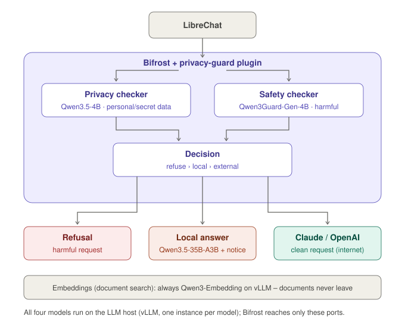

# Privacy guard (optional)

The privacy guard checks every LibreChat request in Bifrost **before** it leaves the house:

- requests with **personal or secret data** are answered by a **local model** – the user sees a notice,
- **harmful requests** (violence, illegal acts, jailbreak …) are **refused**,
- only **clean requests** go to Claude or OpenAI as before.

The checks and the local answers run on vLLM on **separate GPU servers** in the LAN – never on the KIRA server. Document
embeddings are computed locally as well. `setup.sh` asks for it (`PRIVACY_GUARD`); **answered with no, KIRA is installed
exactly as without it** (official Bifrost image, no vLLM, embeddings at OpenAI).

Status: built and unit-tested (decision logic with simulated vLLM servers). The Bifrost build with the plugin and the
models themselves can only be tested on the servers – start in mode `observe`.

## Components

| Component | What | Where |
|---|---|---|
| Plugin `privacy-guard` | Go plugin in Bifrost (HTTP transport hooks): checks, decides, rewrites the request to the local model or answers it (refusal), adds the notice, logs one line per decision | `bifrost/plugins/privacy-guard/kiraguard/` (logic and tests in `guard/`) |
| Bifrost image with plugin | the official image is linked statically and cannot load plugins; `setup.sh` builds the same Bifrost version dynamically together with the plugin (same Go, same base images as the official build) – image `kira/bifrost-guard:<tag>-<hash>`, set as `BIFROST_IMAGE` in `/opt/bifrost/env/versions.env` | `bifrost/plugins/privacy-guard/Dockerfile` |
| vLLM (GPU servers) | one vLLM instance per model, served names `kira-privacy`, `kira-safety`, `kira-embedding`, `kira-answer` | template [`vllm/`](../vllm/README.md) – runs on the GPU servers |
| Bifrost provider `vllm` | embedding and answer model; `allow_private_network` (they are in the LAN); `vk-librechat` (and `vk-docs` for the answer model) may use them | `bifrost.json` (generated) |
| Firewall | Bifrost may reach exactly the four vLLM addresses (ip:port), nothing else in the LAN | `BIFROST_LAN_DST` in `config/egress.env` |
| Slack report | weekly counts per decision and category, can be switched off | `scripts/privacy-report.sh` (cron Mondays 08:10) |

## Models and servers

| Role | Server | Model (proposal) | Served name |
|---|---|---|---|
| Privacy checker | privacy, the GPU for itself | `Qwen/Qwen3.5-35B-A3B` (BF16, weights about 70 GB; fallback the FP8 variant, about 35 GB) with KIRA's checking prompt | `kira-privacy` |
| Safety checker | safety | `Qwen/Qwen3Guard-Gen-8B` | `kira-safety` |
| Embeddings | embedding, a small GPU is enough | `Qwen/Qwen3-Embedding-0.6B` (better search: `-8B`) | `kira-embedding` |
| Answer model | answer | `Qwen/Qwen3.8-Flash-Next-FP8` (fallback `Qwen/Qwen3.8-27B`) | `kira-answer` |

The model behind a name is set on the GPU server (`MODEL=` in the vLLM env file); KIRA only knows the names and the
addresses. Details for each server, including memory needs and the answer model on several GPUs: [vllm/README.md](../vllm/README.md).

**Why two checkers:** the privacy checker follows KIRA's own rules (personal data, passwords, keys, internal systems,
confidential documents) – a general model with a prompt and a fixed JSON schema. Qwen3Guard is trained for harmful
content (fixed categories) and is not precise enough for data rules; its category PII counts as a privacy hit as well.

## Flow of a request

1. LibreChat sends the request as before to Bifrost (`vk-librechat`); the document sync uses `vk-docs` (images of
   scans and handwriting) and is checked the same way. Requests with other virtual keys (Onyx, external services) are
   not checked.
2. The plugin (`HTTPTransportPreHook`, before Bifrost's own plugins) takes everything that would leave the house:
   system prompt, all messages, tool calls and tool results, images. Parts already checked are known by their hash
   (memory cache, 24 h, never stored on disk) – only new parts are checked; long texts in parts of 8,000 characters.
3. **Pattern check** (no model): IBAN (checksum), card numbers (Luhn), e-mail addresses (except example domains), phone
   numbers, private keys, API keys/tokens, `Passwort: …`. A hit is a privacy hit.
4. **Privacy checker** (every part, also images) and **safety checker** (only what the user asks: user messages, image
   prompts, speech text) run **in parallel**, timeout 8 s (`GUARD_TIMEOUT`).
5. **Decision** (first match wins):

| Situation | Action |
|---|---|
| safety `Unsafe` in a blocked category | **refuse** (normal assistant message); suicide/self-harm: a caring message with the Telefonseelsorge (0800 111 0 111 / 0800 111 0 222) and 112 |
| safety `Unsafe` in a logged category, or `Controversial` | continue, only counted |
| privacy hit (pattern, privacy checker or Qwen3Guard PII) | **answer locally** |
| a checker failed or timed out | **answer locally** (fail-closed: nothing leaves unchecked) |
| attached file the checkers cannot read (e.g. a PDF as file part) | **answer locally** |
| body not passed by Bifrost (over 10 MB) | **refuse** (cannot be checked or rewritten) |
| everything clean | **external** as requested |

6. **Answer locally:** model `vllm/kira-answer`, no fallbacks to Claude/OpenAI, no prompt caching parameter, and the
   tools web search and image generation are removed (a search query could carry the data to Google & co.; document
   search and intranet stay – they are in the house). The answer starts with the notice (also when streamed):
   > ⚠️ Lokal beantwortet – deine Anfrage enthielt IBAN, Namen. Sie hat das Haus nicht verlassen.

   Only when the last message is from the user – not again in every intermediate step of a tool call.
7. A chat with a hit **stays local**: its history still contains the data.
8. If the answer model is down, the user gets "Das lokale Modell ist gerade nicht erreichbar … wurde deshalb nicht nach
   außen gesendet."

**Titles:** LibreChat asks for the alias `kira/title`; the guard sends clean titles to Claude Haiku and titles of chats
with a hit to the local model – without notice.

## Other requests

| Request | Handling |
|---|---|
| Embeddings (document search) | **always local** while the guard is on (`EMBEDDINGS_MODEL=vllm/kira-embedding` in `env/rag.env`). After switching, documents uploaded before cannot be searched – upload them again (`setup.sh` warns). |
| Image generation and image edits | prompt is checked; on a privacy or safety hit, or if the check fails: **refused** (no local image model) |
| Speech output (TTS) | text is checked; on a hit **refused** |
| Code interpreter (`CODE_INTERPRETER`) | runs on the KIRA server, uploaded files stay in the house; what the code returns goes back to the model as a tool result and is checked like every other part – with a hit the chat is answered locally (the local answer model keeps the code tool) |
| Documents per agent (`DOCS_ENABLED`, key `vk-docs`) | images of handwriting and photos are checked like chat images: with personal data the local model transcribes (if it can read images) or the file stays untranscribed (`skipped-privacy`, retried after a day); checker down → nothing is sent. Agents with `CONFIDENTIAL=true` use only `DOCS_VISION_LOCAL_MODEL` and answer with `vllm/kira-answer`. The Onyx search itself runs with Onyx's LLM (`vk-onyx`, not checked) – switch it to the local model in Onyx for confidential folders ([docs/README.md](../docs/README.md)) |
| Speech input (STT) | audio cannot be checked before it is transcribed – goes to OpenAI as before; switch speech off (`SPEECH=false`) if that is not acceptable |

## Settings

`setup.sh` asks for the first ones; the others can be added to `env/setup.env` (then run `setup.sh` again).

| Setting (`env/setup.env`) | Meaning | Default |
|---|---|---|
| `PRIVACY_GUARD` | `true` = on; `false` = KIRA as without the guard | asked |
| `GUARD_PRIVACY_URL`, `GUARD_SAFETY_URL`, `GUARD_EMBEDDING_URL`, `GUARD_ANSWER_URL` | address of each vLLM instance (`http://ip:port`) | asked |
| `GUARD_MODE` | `observe` (decide and count, change nothing, checks in the background) · `enforce` | `observe` |
| `GUARD_SLACK` | weekly counts to Slack | asked |
| `GUARD_TIMEOUT` | seconds for the checks of one request | `8` |
| `GUARD_BLOCK_CATEGORIES` | Qwen3Guard categories that are refused (comma-separated) | `Violent,Non-violent Illegal Acts,Sexual Content or Sexual Acts,Suicide & Self-Harm,Jailbreak` |
| `GUARD_LOG_CATEGORIES` | categories that are only counted | `Unethical Acts,Politically Sensitive Topics,Copyright Violation` |
| `VLLM_API_KEY` (in `/opt/bifrost/env/bifrost.env`) | API key of all vLLM instances | asked or generated |

**Start with `observe`:** for one or two weeks the guard only counts what it would do (`scripts/privacy-report.sh 168`).
Check how often it fires and whether wrongly – Qwen3Guard does not name German explicitly among its languages. Then
`GUARD_MODE=enforce` in `env/setup.env` and `bash /opt/kira/setup.sh`.

## Operation

| What | How |
|---|---|
| Is it active? | `bash /opt/kira/scripts/self-test.sh` – section "Privacy guard" (plugin loaded, all four vLLM reachable from Bifrost, local embeddings) |
| Test request | `bash /opt/kira/scripts/self-test.sh --request` – sends a test IBAN, expects `decision=local` |
| Decisions | `docker logs bifrost 2>&1 \| grep 'privacy-guard mode='` – one line per request, categories only, never content |
| Counts | `bash /opt/kira/scripts/privacy-report.sh` (7 days) or `… 24` (hours) |
| Switch off | `PRIVACY_GUARD=false` in `env/setup.env`, `bash /opt/kira/setup.sh` – official Bifrost image, vLLM and plugin removed from `bifrost.json`, embeddings at OpenAI again |
| Bifrost update | change `BIFROST_TAG`, run `setup.sh` – it builds a new image (the tag contains Bifrost version and plugin hash) |

## Troubleshooting

| Symptom | Cause / fix |
|---|---|
| Build fails at `git clone` | `BIFROST_TAG` has no tag `transports/<tag>` on GitHub |
| Build fails at `go build` of the plugin | the plugin uses Bifrost's hook interface; a new major Bifrost version may have changed it – adapt `kiraguard/main.go` (the logic in `guard/` is independent) |
| `plugin was built with a different version of package …` | image and plugin not from the same build – run `setup.sh` again (it always builds both together) |
| self-test: vLLM not reachable | vLLM not started, wrong served name, other API key, port blocked on the GPU server, or `BIFROST_LAN_DST` in `config/egress.env` empty (host name not resolvable) |
| every request is answered locally with "Datenschutzprüfung war nicht möglich" | a checker is down or slower than `GUARD_TIMEOUT` – `docker logs bifrost 2>&1 \| grep 'checker failed'` |
| local answers fail with tools | `--enable-auto-tool-choice` and the right `--tool-call-parser` on the answer server |
| document search finds nothing after switching | documents were embedded with the other model – upload them again |

## Security

- Bifrost reaches only the four vLLM addresses (firewall exception per ip:port); every other LAN address stays blocked.
- The vLLM API key is in `/opt/bifrost/env/bifrost.env` (600) and in the env files on the GPU servers (600) – never in a
  repository. vLLM reads it from the environment (not visible in the process list).
- Traffic in the LAN is plain HTTP. In an untrusted LAN: a reverse proxy with TLS in front of vLLM and `https://…`
  addresses in `setup.sh`.
- The plugin logs decisions and categories, never content. Bifrost itself stores request contents only if
  `LOG_CHAT_CONTENT=true` – unchanged by the guard.
- The checkers are language models: they miss things and fire wrongly. The guard reduces the risk, it is **no
  guarantee** – the data processing agreements with Anthropic/OpenAI remain necessary.

## Limits

- Latency: about 0.5–2 s more per request (checks in parallel, cached parts are free); with agents and tools for every
  intermediate step. In `observe` mode nothing is delayed.
- Every Bifrost update rebuilds the image (5–15 minutes).
- If the GPU servers are off, `enforce` answers every LibreChat request with "lokal nicht verfügbar" (fail-closed).
