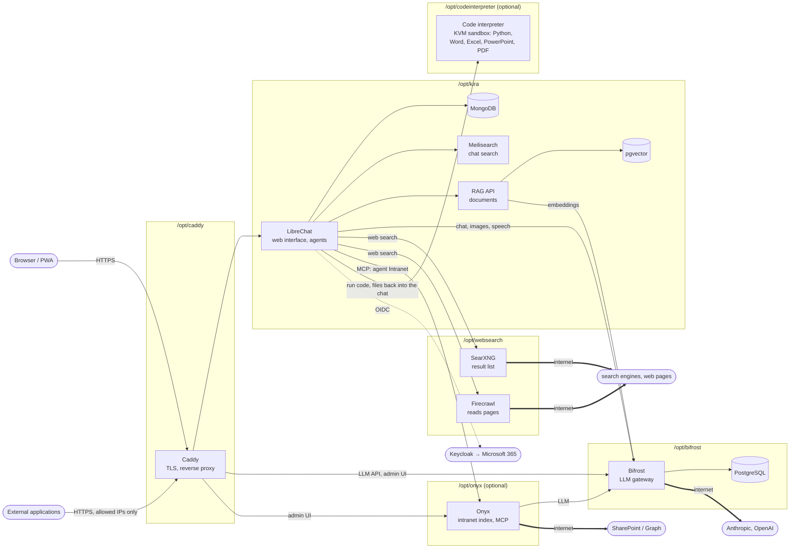
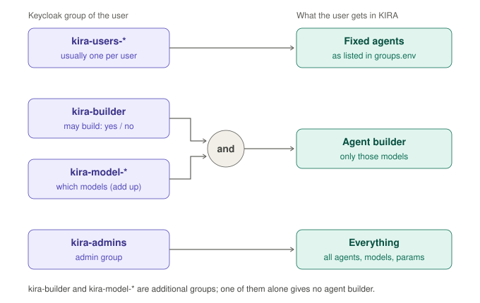

# KIRA – AI assistant (proof of concept)

As of 27.11.2026 · package `kira-stack.zip`, extracted to `/opt`. Chat interface **LibreChat** with fixed agents,
models via the gateway **Bifrost**, web search via **SearXNG + Firecrawl**, intranet search (optional) via **Onyx**,
code and documents (optional) via the **code interpreter** in a KVM sandbox. Login via Keycloak SSO only (forwarding to Microsoft 365).
Step-by-step installation: `INSTALL.md`.

## Architecture



Large version as an image: [docs/architecture.png](docs/architecture.png).

## Modules

| Stack | Service | Task | Why it is included |
|---|---|---|---|
| caddy | Caddy | certificates (Let's Encrypt), HTTPS, forwarding to the services | the only way in from outside; services publish no ports |
| bifrost | Bifrost | one OpenAI-compatible interface for Claude and OpenAI: virtual key per service, budgets, rate limits, fallback, logs | provider keys stay in one place; costs per service (and optionally per user) are visible |
| | PostgreSQL | configuration and logs of Bifrost | |
| kira | LibreChat | KIRA web interface, SSO, agents, file upload, speech, images | ChatGPT-like, MIT licence, agents fixed by configuration |
| | MongoDB | users, chats, agents | LibreChat's database |
| | Meilisearch | search in the user's own chats (search bar) | without it chat search does not work |
| | RAG API + pgvector | splits uploaded documents, embeddings via Bifrost, search for the agents | "ask your document" |
| websearch | SearXNG | meta search (Google, Bing, Brave, Startpage, Mojeek) without account or API costs | returns the result list |
| | Firecrawl (+ Playwright, Redis, RabbitMQ, Postgres) | fetches the result pages and turns them into readable text | the model itself cannot access the internet via the API |
| onyx | Onyx Community Edition | indexes SharePoint (documents, notes …), provides the search via MCP | intranet knowledge without uploading per agent; needs 12–16 GB RAM |
| codeinterpreter | code interpreter ([ClickHouse/code-interpreter](https://github.com/ClickHouse/code-interpreter), Apache 2.0): API, worker, KVM sandbox, file server, Redis, MinIO | runs Python written by the model in a small VM per run: analyses, charts and documents (Word, Excel, PowerPoint, PDF, CSV) | files appear directly in the chat with preview and download; built from source, needs `/dev/kvm` – [codeinterpreter/README.md](../codeinterpreter/README.md) |

## Connections and networks

Diagram and container × network table: [NETWORK.md](NETWORK.md).

All networks have fixed subnets. "internal" = without internet access. Networks with internet are separated from
LAN and host by the **LAN block** (`scripts/egress-firewall.sh`, switch `LAN_BLOCK`) – the only exception is Keycloak on port 443, and only for LibreChat and Onyx.
With Keycloak in the LAN (`KEYCLOAK_INTERNAL_IP`) LibreChat gets no internet at all, only Keycloak:443 and DNS.

| Network | Subnet | Who | Purpose |
|---|---|---|---|
| `kira-proxy` | 172.30.20.0/24, internal | Caddy (.2), LibreChat, Bifrost, Onyx nginx | Caddy → services |
| `kira-llm` | 172.30.21.0/24, internal | Bifrost, LibreChat, RAG API, Onyx | models/embeddings via Bifrost |
| `kira-search` | 172.30.22.0/24, internal | LibreChat, SearXNG, Firecrawl | web search |
| `kira-onyx` | 172.30.23.0/24, internal | LibreChat, Onyx MCP | agent "Intranet" |
| `kira-code` | 172.30.29.0/24, internal | LibreChat, code interpreter API (`codeapi`) | run code |
| `*_backend` | 172.30.24–27.0/24, internal | each stack's databases | databases only within their own stack |
| `codeinterpreter_backend` | 172.30.30.0/24, internal | all code interpreter services | sandbox ↔ egress gateway, file server, Redis, MinIO – no internet |
| `kira-edge` | 172.31.60.0/24 | Caddy | certificates |
| `bifrost-outbound` | 172.31.61.0/24 | Bifrost | Anthropic, OpenAI |
| `kira-outbound` | 172.31.62.0/24 | LibreChat | Keycloak (OIDC) – with `KEYCLOAK_INTERNAL_IP` nothing else (no internet) |
| `websearch-outbound` | 172.31.63.0/24 | SearXNG, Firecrawl | search engines, web pages |
| `onyx-outbound` | 172.31.64.0/24 | Onyx | SharePoint, Hugging Face (models on first start) |

MongoDB, Meilisearch, pgvector, the RAG API and all databases have no internet access.

## Installation

Requirements: Ubuntu Server (24.04 LTS recommended), Docker with Compose ≥ 2.20, `python3`, `curl`, `openssl`; about
8 GB RAM without Onyx, 24 GB with Onyx. With the code interpreter additionally: hardware virtualisation (`/dev/kvm` –
bare metal or a VM with nested virtualisation, **not** an LXC container), Compose ≥ 2.24, `git`, about 2 GB RAM per
parallel code run (`CODE_PARALLEL`, default 4) and 30 GB disk for its images. Ports 80 and 443 must be free. The certificates live in the volume `caddy_data` and survive a reinstall.

```bash
unzip -o kira-stack.zip -d /opt          # creates /opt/caddy, bifrost, kira, websearch, onyx, codeinterpreter – on the server
# optional: take over the Keycloak client (setup.sh then does not ask for it)
umask 077; scp root@<keycloak-host>:/opt/keycloak/env/kira-client-kira.env /opt/kira/env/keycloak-client.env
bash /opt/kira/setup.sh                  # asks everything, sets permissions, starts on request and tests
```

`setup.sh` creates the secrets, generates the configurations, the Docker networks, the LAN block (systemd) and
`/etc/cron.d/kira` (monitoring, backup, cost report). Running it again is safe. Start order:
bifrost → websearch → codeinterpreter → kira → onyx → caddy – via CLI from `setup.sh` or in Portainer
(paste `/opt/<stack>/docker-compose.yml` for each stack, no environment variables). The code interpreter is built
from source and is only started by `setup.sh` (or `codeinterpreter/codeapi.sh`), not in Portainer.

**Keycloak** (client `kira`): valid redirect URI `https://<kira-domain>/oauth/openid/callback`, post-logout redirect
`https://<kira-domain>/login`; PKCE S256; mapper "User Client Role" with claim name `roles` in the **ID token**.
Role `user` = access, `admin` = admin in KIRA. Then open `https://<kira-domain>`.

Check: `/opt/kira/scripts/self-test.sh` (additionally `--request` for a real mini request to Claude).

## Switches (`/opt/kira/env/setup.env`)

To change: edit the value (`true`/`false`), then `bash /opt/kira/setup.sh` – it regenerates everything derived and
restarts the affected services.

| Switch | Effect |
|---|---|
| `ONYX_ENABLED` | Onyx and agent "Intranet" on/off |
| `ONYX_ALLOWED_IPS` | IPs that may open the Onyx web interface (admins); only used when `onyx.caddy` is generated |
| `SEND_USER_HEADERS` | LibreChat sends the user's e-mail, name and ID to Bifrost → costs per user in the Bifrost logs and the monthly report. **Only with the users' knowledge.** |
| `LOG_CHAT_CONTENT` | Bifrost stores questions and answers (as long as `BIFROST_LOG_RETENTION`). **Only with the users' knowledge.** Both `false` = usage per service only. |
| `IMAGE_GENERATION`, `IMAGE_MODEL` | image generation (image agent) |
| `SPEECH`, `STT_MODEL`, `TTS_MODEL`, `TTS_VOICE` | speech input/output via Bifrost (`TTS_MODEL` empty = input only). Preset for all users: engine "External", German, transcribe automatically (sensitivity −65 dB) and send after 3 s, voice `TTS_VOICE` (default `fable`), read aloud only on click. Users' own changes are kept |
| `LOGIN_DURATION` | how long a login stays active, `8h` to `365d` (default `30d`); counted from login, then SSO again (usually without input) |
| `MESSAGE_LIMIT` | at most this many messages per user and minute (empty = 20, `0` = no limit); above it users get a notice, no ban |
| `TERMS_ENABLED` | accept the terms of use at first login; text in `config/terms-of-use.md` (created from the template the first time – only the contact line needs to be filled in). First line `# …` = heading. Placeholders are filled from `setup.env` on every run: `{{CHAT_RETENTION}}`, `{{TEMP_CHAT_RETENTION}}`, `{{LOG_RETENTION}}`, `{{USER_IN_LOGS}}`, `{{LOG_CONTENT}}`, `{{MESSAGE_LIMIT}}` – so the text always matches the settings. Users who decline are logged out |
| `PRIVACY_URL`, `HELP_URL` | link to the privacy policy (bottom of the start page) and help page in the user menu; empty = no link |
| `CHAT_RETENTION` | delete all chats including files automatically, `1d` to `365d` **from the start of the chat** (empty = never). Applies to chats created or continued after switching it on |
| `TEMP_CHAT_RETENTION` | delete temporary chats after `1h` to `365d` (empty = 24h) |
| `CONTEXT_USAGE` | "context window" panel (token usage and the "compress context" button) for all users; default off |
| `COMPACT_AT` | context limit per chat in tokens (empty = 100000, `0` = model limit, about 900000): above it Claude Haiku summarises the older parts, the last 2 turns stay verbatim. Lowers the cost of long chats; details from far above are only kept in summary afterwards. Does not apply to the image agent (separate stored agent) |
| `AGENT_GROUPS` | agents per Keycloak group (section "Agents per Keycloak group") |
| `BIFROST_LOG_RETENTION` | retention of the Bifrost logs in days, e.g. `90d` (1d to 3650d; empty = 90d) |
| `UPLOAD_MAX_MB`, `UPLOAD_MAX_FILES` | largest file 1–50 MB (empty = 20), files per message 1–50 (empty = 10) |
| `UPLOAD_OFFICE_ONLY` | only PDF, Word/Excel/PowerPoint, OpenDocument, RTF, text (incl. CSV, Markdown, code) and images; no ZIP, audio, video or program files |
| `LAN_BLOCK` | LAN block for all containers with internet access |
| `UPSTREAM_PROXY_IP` | upstream reverse proxy: Caddy only trusts it for the client IP, certificates via HTTP-01 only |
| `KEYCLOAK_INTERNAL_IP` | Keycloak directly in the LAN (extra_hosts + exception in the LAN block); LibreChat then gets no internet, only Keycloak:443 and DNS |
| `LLM_API_DOMAIN`, `BIFROST_UI_DOMAIN` (+ `…_ALLOWED_IPS`) | LLM API for external applications and Bifrost web interface from outside |
| `AGENT_BUILDER` | only switch via `scripts/agent-builder.sh on|off` |
| `CODE_INTERPRETER`, `CODE_PARALLEL` | code interpreter (stack codeinterpreter, needs `/dev/kvm`): analyses, charts and documents in the chat; `CODE_PARALLEL` = runs at the same time (1–16, default 4) – section "Code interpreter" |
| `PRIVACY_GUARD`, `GUARD_*` | privacy guard with own LLMs on vLLM servers: personal/secret data answered locally, harmful requests refused – [PRIVACY-GUARD.md](PRIVACY-GUARD.md). `false` = as without it |

## Agents

The agents live in `/opt/kira/agents/` – per agent one `.env` (settings) and one `.md` (instruction).
Field description in `agents/README.md`. Users only see these agents, no raw models, no parameters.
Titles, descriptions and instructions are German, as the users see them.

| Agent (`NAME`) | Title (as shipped) | Model | Web search | Files | Intranet | Images |
|---|---|---|---|---|---|---|
| `kira` (default) | KIRA | Claude Sonnet 5.5 | yes | yes | – | – |
| `code` | Code | Claude Opus 5.5 | yes | yes | – | – |
| `intranet` | Intranet | GPT-6.1 Terra | – | – | yes (Onyx) | – |
| `images` | as `TITLE` in `40-images.env` | Claude Haiku 5.5 (prompt), image: `IMAGE_MODEL` | – | yes | – | yes |
| `writing` | Textwerkstatt | Claude Sonnet 5.5 | – | yes | – | – |
| `minutes` | Protokoll | Claude Sonnet 5.5 | – | yes | – | – |

Titles of chats and summaries of long chats: Claude Haiku 5.5. Opus ignores `TEMPERATURE` (Bifrost drops it).

### Image agent

In LibreChat the image tool only exists for agents from the database, not for agents from the configuration.
Create the image agent once:

1. `/opt/kira/scripts/agent-builder.sh on` (temporarily allows creating/sharing and shows the endpoint selection)
2. As admin in KIRA: side panel **Agent Builder** ("Agenten erstellen") → new agent: name and description as
   `TITLE`/`DESCRIPTION` in `agents/40-images.env`, endpoint **Bild-Agent**, model `anthropic/claude-haiku-5-5`
   (the image comes from `IMAGE_MODEL`),
   copy the instruction from `agents/40-images.md`, add the tool **"OpenAI Image Tools"**, upload
   `agents/40-images.png` as the avatar (click the round picture at the top) – so the start page shows the same
   icon as the other agents – and enter `KIRA` at "Ansprechpartner-Kontakt" (otherwise your name appears there), save.
3. Share → **with everyone** (role "Viewer"). Copy the agent ID (`agent_…`).
4. Enter it at `AGENT_ID=` in `agents/40-images.env`, then `/opt/kira/scripts/agent-builder.sh off`.

The image agent runs on its own endpoint **"Bild-Agent"** (same Bifrost key, only Haiku), so that the provider limits
of the model groups (see "Own agents") do not block it. `agent-groups.sh` (called by `setup.sh` and
`agent-builder.sh`) moves an image agent that was saved with another endpoint there automatically.
If the image tool is removed from the image agent by mistake, `agent-groups.sh` adds it again.

### Agents per Keycloak group

Switch `AGENT_GROUPS=true`, mapping in `agents/groups.env` (from the template `groups.env.example`, not overwritten
by new packages). One line per group `<Keycloak group>=<agents>`; `ADMIN_GROUP=` names the admins' group
(sees all agents).

**No group, no agent:** only users with one of the listed groups or the admin group in the `groups` claim can log in
(`OPENID_REQUIRED_ROLE`). **Admins are then the members of `ADMIN_GROUP`** (`OPENID_ADMIN_ROLE` switches from the
client role `admin` to the group) – put every admin into `kira-admins` before switching on, otherwise they lose admin
rights at their next login. Users who are logged in and lose their group see no agent after their next login
(role `USER` without endpoint). New accounts land in `kira-users-default` automatically via Keycloak's default group.

How it works: `setup.sh` calls `scripts/agent-groups.sh`. It creates one LibreChat role per group with the same name
(permissions like normal users) and its own agent list, and switches on the role sync: LibreChat reads the `groups`
claim from the ID token at login. **Exactly one group applies per user** – with several, the one with the most agents
(tie: order in the file). The mapping applies from the next login; users who are already logged in have to log out
and in once (until then they see no agent).

Once in Keycloak (realm `kira`):
1. Create the groups (e.g. `kira-users-it`, `kira-users-default`, `kira-users-custom`); put each user in exactly one group.
2. *Clients* → `kira` → *Client scopes* → `kira-dedicated` → *Add mapper* → *By configuration* →
   **Group Membership**: name and *Token Claim Name* `groups`, **Full group path off**, *Add to ID token* on.
3. **Default group:** *Realm settings* → *User registration* → *Default groups* → `kira-users-default`. New accounts (also on
   first login via Microsoft 365) land in `kira-users-default` automatically; assign existing accounts without a group once by
   hand (default groups do not apply retroactively).
4. Check: *Client scopes* → *Evaluate* → test user → *Generated ID token*: `"groups": ["kira-users-it"]`.

To change: edit `agents/groups.env`, `bash /opt/kira/setup.sh` (or just `scripts/agent-groups.sh`); the script
deletes removed groups in LibreChat. To switch off: `AGENT_GROUPS=false`, `setup.sh` – login via the roles
`user`/`admin` applies again (admins via the client role `admin`) and everyone sees all agents.

### Own agents (builder and model groups)

Optional, only with `AGENT_GROUPS=true`. Three kinds of Keycloak groups, each with one job:

| Group | Says | Example |
|---|---|---|
| agent group | which fixed agents someone sees | `kira-users-it` |
| `BUILDER_GROUP` | whether someone may build own agents (yes/no) | `kira-builder` |
| model group | which models they may use for that | `kira-model-default` |



Builder = member of `BUILDER_GROUP` **and** of at least one model group. One of the two alone gives no agent builder:
`kira-builder` says *whether*, the model groups say *with what*. Several model groups add up. Admins need neither.
The agent group is independent of this – it only decides which fixed agents appear, and the fixed agents keep their
models (e.g. "Code" stays on Opus, even if the builder may only use Sonnet).

Examples (groups as in `agents/groups.env.example`):

| User | Keycloak groups | Fixed agents | Agent builder | Models in the builder |
|---|---|---|---|---|
| Anna | `kira-users-it` | IT agents | no | – |
| Ben | `kira-users-it`, `kira-builder`, `kira-model-default` | IT agents | yes | Haiku, Luna, Terra |
| Clara | `kira-users-default`, `kira-builder`, `kira-model-default`, `kira-model-plus` | default agents | yes | Haiku, Sonnet, Luna, Terra, Sol |
| David | `kira-users-default`, `kira-model-premium` | default agents | no – `kira-builder` missing | – |
| Eva | `kira-users-custom`, `kira-builder` | custom agents | no – model group missing (the sync reports it) | – |
| Admin | `kira-admins` | all | yes | all, with all parameters |

```
# agents/groups.env
BUILDER_GROUP=kira-builder
builder.kira-model-default=anthropic/claude-haiku-5-5,openai/gpt-6-luna,openai/gpt-6.1-terra
builder.kira-model-plus=anthropic/claude-sonnet-5-5,openai/gpt-6.1-sol
builder.kira-model-premium=anthropic/claude-opus-5-5,openai/gpt-6-astra
```

The tiers do not overlap: whoever should also use cheaper models gets the other model groups too. The models must be allowed for the key
`vk-librechat` in Bifrost – `setup.sh` checks this against `bifrost.json` (catches typos such as `gpt-6.1-luna`).

How it works:

- Per provider there is an endpoint, shown as "Anbieter" in the agent builder: **"Anthropic"**, **"OpenAI"** (others
  by their provider name) – same Bifrost key, with all builder models of that provider. Below it, each user only sees
  the models of their own model groups: `builder-sync.py` narrows the model list per user, and LibreChat checks the
  model on every message. Only "Anthropic" gets prompt caching (`cache_control`) – Bifrost would pass it on to OpenAI,
  which rejects it. `endpoints.agents.allowedProviders` lets stored agents run only on the endpoints
  of the user's model groups (checked by LibreChat on every message, not only in the interface).
- LibreChat knows only one role per user and does not take over Keycloak groups by itself (only with Entra ID).
  Therefore `scripts/builder-sync.py` reads the members of `BUILDER_GROUP` and the model groups every 5 minutes via the Keycloak admin
  API (cron, syslog `journalctl -t kira-builders`) and gives each member a personal LibreChat profile (user config,
  priority 137): builder visible, their providers and models, own agents selectable ("Meine Agenten" next to the fixed agents).
  Changes apply within about 5 minutes plus 1 minute cache and a page reload – no restart. Users who have never logged in
  get their profile after their first login (next run). Leaving `BUILDER_GROUP` or all model groups removes the profile; their own
  agents stay stored but cannot be used any more.
- The agent group roles get the permission "create agents"; for everyone else the builder stays
  hidden (`disableBuilder`) and their stored agents could not run anyway (`allowedProviders`, model specs enforced).
- Own agents are private: sharing stays off.
- Tool library: only "OpenAI Image Tools" (with image generation on), no Google, Wolfram, Tavily, Flux …
  (`includedTools`). Everyone who can build agents may add the image tool to their own agents (images go over the
  same Bifrost key and budget).
- "Übergaben" (handoffs) is always in the tool library: LibreChat v0.8.9 has no capability or role permission for it
  (intentionally – it ignores `capabilities`). Uncritical: a builder can only hand over to agents they can see
  themselves (their own and the image agent, not the fixed KIRA agents), so no model of a higher tier can be reached.
  Normal users never see the agent builder.
- Kept simple: in the model parameters only **Temperatur** and **Denkaufwand** (reasoning effort; more quality for
  hard tasks, but more tokens and time) can be set; everything else (token limits, reasoning summary, stop sequences,
  Responses API, …) is hidden and not sent (`dropParams`). Long chats are summarised from `COMPACT_AT`
  like the fixed agents (`tokenConfig` of the endpoint). The endpoint "Bifrost" never appears for builders – only
  their providers ("Anthropic", "OpenAI", …) and "Bild-Agent".
- **Admins** (members of `ADMIN_GROUP`, e.g. `kira-admins`) get the builder without `BUILDER_GROUP` or a model group (as
  soon as at least one `builder.…` line exists): all models and all parameters (only the Responses API and OpenAI's own
  web search stay off – Bifrost does not serve them). Extra parameters only take effect when the admin chats with the
  agent; for everyone else LibreChat drops them again (their profile only allows Temperatur and Denkaufwand).
- Errors of the sync go to Slack once (German) and again when it works again.

Once in Keycloak (realm `kira`):
1. Create the groups (top level): `kira-builder` and the model groups `kira-model-default`, `kira-model-plus`,
   `kira-model-premium`; add the users – in addition to their agent group.
2. *Clients* → *Create client*: client ID `kira-sync`, **Client authentication on**, only **Service accounts roles**
   (no standard flow) → save → tab *Credentials*: copy the client secret.
3. Tab *Service accounts roles* → *Assign role* → filter by clients → `realm-management`: **view-users** and
   **query-groups**.
   Keycloak 26.8.2 or newer: tab *Client scopes* → *Add client scope* → **kc-admin-api** → *Add* → **Default**
   (the Admin REST API only accepts tokens with this scope/audience, otherwise HTTP 401).
4. If a proxy in front of Keycloak blocks `/admin` (on id.example.com: `@admin_external` in
   `/opt/keycloak/caddy/*.caddy`), allow this server read-only access to the groups – inside the matcher:
   ```
   not {
   	client_ip <KIRA-IP>
   	method GET
   	path /admin/realms/kira/groups /admin/realms/kira/groups/*
   }
   ```
   Otherwise the sync ends with "HTTP 403 … a proxy in front of Keycloak blocks /admin".
5. Enter the builder lines in `agents/groups.env`, `bash /opt/kira/setup.sh` – it asks once for client ID and secret
   (`env/keycloak-sync.env`) and runs the first sync. Check any time: `python3 /opt/kira/scripts/builder-sync.py
   --dry-run` (members and endpoints, changes nothing).

Limits: builders can, with hand-made API requests, still reach the endpoint "Bifrost" (all models of
the fixed agents), because model specs are not enforced for them – the interface does not offer it. Costs run over
the same key and budget as the fixed agents. The endpoint "Bild-Agent" (Haiku) is also offered in the builder,
because the image agent needs it. With Onyx, builders can also add the MCP server "intranet" to their own agents –
they then search the intranet even if their agent group does not include the agent "Intranet". Only make people
builders who may see the intranet content.

## Onyx (intranet search)

The Onyx web interface is only reachable from `ONYX_ALLOWED_IPS` (`setup.sh` asks; Caddy answers 404 to everyone
else). Reason: Onyx has its own accounts with open sign-up, the first account becomes admin, and every further account
could search the indexed intranet content. KIRA itself talks to Onyx internally (MCP) and is not affected.

1. Open `https://<onyx-domain>` from an allowed IP and create the first account **right after the start** – it becomes
   admin. Then restrict sign-up in the Onyx admin settings to invited users (invite-only; the label may differ between
   versions). (Optionally SSO via Keycloak later: Admin → Organization → SSO Providers → OIDC; included in the
   Community Edition.)
2. **LLM:** Admin → LLM providers → OpenAI-compatible/custom: base URL `http://bifrost:8080/v1`,
   API key `VK_ONYX` (`grep ^VK_ONYX /opt/bifrost/env/bifrost.env`), models e.g. `anthropic/claude-sonnet-5-5`.
3. **API key for KIRA:** Admin → API Keys → new key (role Basic), then `bash /opt/kira/setup.sh` – it asks for the key
   and shows the agent "Intranet".
4. **SharePoint:** in Entra create an app registration with the application permission **`Sites.Selected`** (instead of
   `Sites.Read.All`) and grant it read access only to the released sites via Microsoft Graph (e.g. documents,
   notes). In Onyx create the connector "SharePoint" with tenant ID, client ID, secret and the site URLs. Onyx then only
   sees what everyone may see – taking over SharePoint permissions is only available in the paid version.

OpenSearch needs `vm.max_map_count=262144` on the host (for LXC set it on the Proxmox host; `setup.sh` warns).

## Code interpreter

With `CODE_INTERPRETER=true` the agents with `CODE=true` (KIRA, Code, Textwerkstatt, Protokoll) run Python in a
sandbox. That covers calculations, analyses of uploaded files, charts – and **documents**: the model writes the file
with python-docx, openpyxl, python-pptx or reportlab to `/mnt/data`, and LibreChat shows it **in the chat** – Word,
Excel and PowerPoint with a preview in the side panel, every file with a download button. The files are stored in
LibreChat like uploads (deleted with the chat, `CHAT_RETENTION`).

```
LibreChat ── kira-code ──► codeapi (API) ─► worker ─► sandbox: one small VM per run (own kernel, no network)
 (signed token, Ed25519, 5 min)                       └► egress gateway ─► file server ─► MinIO   (all internal)
```

- Stack `/opt/codeinterpreter`: `setup.sh` clones the pinned release (`CODEAPI_VERSION` in `env/versions.env`) to
  `src/`, generates the secrets (`env/codeapi.env`) and builds the images – the first build takes 30 minutes or more,
  later runs of `setup.sh` only build again when the version changes.
- Login: LibreChat signs a token per request with its private key (`env/librechat.env`); the code interpreter only
  knows the public key. No published ports, no internet, no LAN – the sandbox only reaches the egress gateway.
- Own templates (letterhead): upload the `.docx`/`.pptx` in the chat and ask KIRA to use it.
- Operation: `bash /opt/codeinterpreter/codeapi.sh ps | logs --tail 50 <service> | restart` – details in
  [codeinterpreter/README.md](../codeinterpreter/README.md).

## Operations

| What | How |
|---|---|
| Bifrost web interface (logs, costs, budgets) | `ssh -L 8080:127.0.0.1:8080 root@<host>`, then `http://localhost:8080`; login: `grep ^BIFROST_ADMIN /opt/bifrost/env/bifrost.env` |
| Models, budgets, keys | `/opt/bifrost/config/bifrost.json` (authoritative, changes in the web interface are lost on restart), then `docker restart bifrost` |
| Add an external service | add `VK_EXT_<NAME>=sk-bf-…` to `/opt/bifrost/env/bifrost.env` (`openssl rand -hex 24`), create a virtual key `vk-<name>` with budget in `bifrost.json` like the existing ones, `docker restart bifrost`; the service uses the LLM API with this key |
| Change the terms of use | edit `config/terms-of-use.md`, `bash /opt/kira/setup.sh`, then `scripts/terms-reset.sh` – all users have to accept again (LibreChat does not remember a version) |
| Costs per user/key | `/opt/kira/scripts/usage-report.sh current` (monthly to Slack automatically; Slack messages are in German) |
| Monitoring | cron every 5 min: container health → Uptime Kuma push "KIRA Container", budget warnings → Slack |
| Own agents (builder and model groups) | cron every 5 min `scripts/builder-sync.py` (only with `builder.…` in `agents/groups.env`); check `python3 /opt/kira/scripts/builder-sync.py --dry-run`, log `journalctl -t kira-builders` |
| Backup | daily at 02:30 to `/var/backups/kira/<date>/` (Bifrost DB, MongoDB, RAG, Onyx DB, uploads, `/opt` stacks incl. secrets), 14 days; push "KIRA Backup" |
| Versions | edit `/opt/<stack>/env/versions.env`, redeploy the stack. Back up first. Pinned versions instead of `latest` where possible. With the privacy guard, Bifrost: change `BIFROST_TAG`, then `setup.sh` (builds the image with the plugin) |
| Caddy | site blocks `/opt/caddy/config/sites/*.caddy` freely editable, `docker exec caddy caddy reload --config /etc/caddy/Caddyfile` |
| Code interpreter | `bash /opt/codeinterpreter/codeapi.sh ps` · `… logs --tail 50 sandbox-runner`; end-to-end test: `scripts/self-test.sh` (section "Code interpreter"); update: `CODEAPI_VERSION` in `/opt/codeinterpreter/env/versions.env`, then `setup.sh` |
| Privacy guard | decisions `docker logs bifrost 2>&1 \| grep 'privacy-guard mode='`, counts `scripts/privacy-report.sh` – [PRIVACY-GUARD.md](PRIVACY-GUARD.md) |
| Logo and favicon | replace the files in `/opt/kira/branding/`, `bash /opt/kira/setup.sh` (restarts LibreChat) – section "Branding" |

**Restore** (stop the stack, start only the database): `pg_restore -U postgres -d bifrost --clean` (Bifrost;
`rag.dump` the same way in `librechat-vectordb`, `onyx.dump` in `onyx-db`) or `mongorestore --archive --gzip --drop`
(with the user from `env/mongodb.env`, `--authenticationDatabase admin`) with the files from the backup; uploads and
images: `zcat librechat-uploads.tar.gz | docker cp - librechat:/app` and
`zcat librechat-images.tar.gz | docker cp - librechat:/app/client/public`. Extract `opt-stacks.tgz` to `/opt` if
needed (on a new server **before** the package – it holds the secrets). The Meilisearch and OpenSearch indexes are
rebuilt.

## Branding

LibreChat has no setting for its logo and favicon – they are files in the image. The stack mounts its own files from
`/opt/kira/branding/` read-only over them (`compose.yml`), so the image stays unchanged and updates keep the logo.

| File in `branding/` | Size | Shown as |
|---|---|---|
| `favicon-16x16.png`, `favicon-32x32.png` | 16 / 32 px, transparent corners | browser tab |
| `apple-touch-icon-180x180.png` | 180 px, square without transparency (iOS rounds it) | iPhone/iPad home screen |
| `icon-192x192.png` | 192 px | installed app (Android, Chrome) |
| `maskable-icon.png` | 512 px, square, symbol within the inner 80 % (Android crops to circle/squircle) | installed app (Android) |
| `logo.svg` | any, square | login page |
| `manifest.webmanifest` | – | name ("KIRA"), colours and icons of the installed app |

The tab title comes from `APP_TITLE=KIRA` (setup.sh). To change the logo: replace the files (same names and sizes), run
`bash /opt/kira/setup.sh` – it notices the change and restarts LibreChat (a replaced file only reaches the container
after a restart). `scripts/self-test.sh` checks that the container serves the files from `branding/`.
Browsers keep favicons for a long time: after a change reload hard (Ctrl+F5) or delete the site data; an installed
KIRA app may have to be installed again.

## Troubleshooting

| Message | Cause / solution |
|---|---|
| `$'\r': command not found` when starting setup.sh | file edited on Windows: `sed -i 's/\r$//' /opt/kira/setup.sh` |
| `env file … not found` in Portainer | `setup.sh` has not run, or Portainer has no volume `/opt:/opt:ro` |
| images cannot be pulled | check tag/registry in `env/versions.env` (LibreChat: fall back to `ghcr.io/librechat-ai/…`) |
| `setup.sh`: "CODE_INTERPRETER=true needs /dev/kvm" | no hardware virtualisation: in a VM enable nested virtualisation and CPU type `host`; in an LXC container it does not work – `CODE_INTERPRETER=false` |
| code interpreter: build fails | `bash /opt/codeinterpreter/codeapi.sh build` shows the step; needs internet (GitHub, Docker Hub, package mirrors) and about 30 GB disk |
| code interpreter: 401 in the self-test | key pair changed – run `setup.sh` again (it writes the public key to `codeinterpreter/env/codeapi.env`), then `bash /opt/codeinterpreter/codeapi.sh up -d` |
| code interpreter: runs hang or fail with 5xx | `codeapi.sh logs --tail 80 service-worker sandbox-runner`; `codeapi-sandbox` unhealthy = `/dev/kvm` missing in the container or clock skew of the host (NTP) |
| document appears only as a download, without preview | preview only for Word, Excel, PowerPoint and CSV up to a few MB; other files (PDF, images in files) are download-only |
| SSO: "You must have … role" | claim `roles` (or `groups` with `AGENT_GROUPS=true`) missing in the ID token, or user in no permitted group |
| SSO: `redirect_uri` invalid | add the redirect URI in the Keycloak client (see Installation) |
| SSO: error 500 / timeout at login | LibreChat cannot reach Keycloak: `KEYCLOAK_INTERNAL_IP`, LAN block exception, firewall of the Keycloak server |
| agent does not answer / 401 | `BIFROST_API_KEY` (librechat.env) ≠ `VK_LIBRECHAT` (bifrost.env); `docker logs bifrost` |
| 402 | a budget is used up – increase `max_limit` in `bifrost.json` or wait for the time window |
| web search empty | `docker logs searxng`; search engine blocked (CAPTCHA) – enable others in `searxng/settings.yml` |
| agent "Intranet" missing | Onyx off or `ONYX_API_KEY` missing → Onyx step 3; after an Onyx restart `docker restart librechat` |
| MongoDB does not start ("Illegal instruction") | CPU without AVX (e.g. Proxmox CPU type kvm64) – CPU type `host` |
| OpenSearch exits | `vm.max_map_count` too small (see Onyx) or too little RAM |
| many users cannot get in | limits for shared IPs are already raised (`LOGIN_MAX`, no IP bans); `docker logs librechat` |
| builder sees no "Agenten erstellen" | `python3 /opt/kira/scripts/builder-sync.py` (errors, members); user must be in `BUILDER_GROUP` and a model group, have logged in once and be in an agent group; wait 1 minute |
| user sees no agents / wrong agents | `bash /opt/kira/scripts/user-check.sh <e-mail>` – role, agent list, builder profile; role `USER` = no matching group at the last login (fix in Keycloak, log out and in) |
| `builder-sync.py`: Keycloak HTTP 401/403 | `bash /opt/kira/scripts/keycloak-check.sh` – token content and groups API (401 = client scope `kc-admin-api` missing, 403 = roles `view-users`/`query-groups` or `/admin` blocked by the proxy in front of Keycloak) |
| "An error occurred while processing the audio" | the speech recognition returned no text (silence, microphone, sensitivity) or a server error – `docker logs librechat \| grep -i stt` |

## Security

Full review with threat model, test results and residual risks: [SECURITY.md](SECURITY.md).

What the package does:

- **Login only via Keycloak** (PKCE, required role/group); no local accounts, registration, password reset or shared
  links in LibreChat. Users cannot build agents (except builders, see "Own agents"), prompts, MCP servers or
  presets; memories are off; code runs only in the KVM sandbox of the code interpreter (if switched on).
- **Networks:** databases have no internet; internal networks between the stacks; only Caddy publishes ports. The
  LAN block stops containers with internet from reaching the LAN and the host (exceptions: Keycloak :443 for LibreChat and Onyx only, DNS).
  With Keycloak in the LAN, LibreChat has no internet at all (only Keycloak and DNS).
- **Bifrost:** virtual key required for every request, no direct provider keys, admin login for the web interface,
  web interface on 127.0.0.1 only (SSH tunnel) or allowed IPs; LLM API from allowed IPs, OpenAI endpoints only.
  CORS only for the Bifrost web interface itself (`allowed_origins`), so scripts on other pages cannot use the admin
  API of a logged-in admin. Chat contents are not logged unless switched on (`LOG_CHAT_CONTENT`).
- **Onyx** from allowed IPs only (see above). **Web search:** the LAN block stops Firecrawl and its browser from
  reaching private addresses (SSRF via redirects – CVE-2024-56800 is fixed in the Firecrawl API, its Playwright
  service is not patchable upstream). Firecrawl and SearXNG are only reachable from LibreChat; RabbitMQ runs without
  its management web interface.
- **Agents:** no OpenAPI actions, no own MCP servers – an agent cannot call arbitrary addresses
  from inside the stack; internal addresses for web search, endpoints and MCP are allow-listed (`allowedAddresses`).
- **Secrets** only in `env/` (700/600), generated randomly; not in Portainer, not in the package. Slack and Uptime Kuma
  URLs are passed to curl via `-K`, not on the command line.
- Links of the form `…?prompt=…&submit=true` only fill in the prompt (`autoSubmitFromUrl: false`); `/api/config`
  shows no build information (`buildInfo: false`).
- Containers with `no-new-privileges`, `cap_drop: ALL` (except Onyx and the Firecrawl API – their images need the default
  capabilities), memory and process limits (except Onyx), log rotation; no container gets the Docker socket.
- **Builder sync:** the Keycloak service account only reads users and groups (`view-users`, `query-groups`); its
  secret and the token go to curl on stdin; the state file (Keycloak user IDs) is readable by root only.

Recommended outside the package (not checkable from here):

- **Firewall** of the server (or the hypervisor): TCP 80/443 only from <PROXY-IP>, 22 and 9443 (Portainer = root on
  the host) only from the admin network.
- **Backups** in `/var/backups/kira` contain the secrets from `env/` and all chats unencrypted (folder 700) – copy them
  only encrypted to another system.
- **Pin image versions:** `SEARXNG_TAG`, `FIRECRAWL_PLAYWRIGHT_TAG` and `FIRECRAWL_NUQ_TAG` are `latest`;
  if needed pin them by digest (`image@sha256:…`) after a successful start.
- **Budget:** all KIRA users share one virtual key – one user can use up the budget for everyone; the message limit
  per user (`MESSAGE_LIMIT`) slows this down.
- Updates: check LibreChat/Bifrost/Onyx releases for security fixes regularly and raise the tags in `env/versions.env`.
- **Known residual risks** (accepted): builders reach the endpoint "Bifrost" of the fixed agents with hand-made API
  requests (see "Own agents"); Firecrawl's Redis has no password (internal network only, Redis refuses HTTP-style
  requests); MongoDB backup and `terms-reset.sh` pass the database password on the command line (root-only host);
  no Content-Security-Policy for LibreChat (its artifacts load code from external sandboxes).

## Notes

- **Interface for users:** bookmarks (labels for chats) on; prompt library, memories, presets, marketplace off;
  "+"/multiConvo (two answers side by side) only for admins. Set in `scripts/librechat-config.py` (`interface`);
  the group roles take their permissions from there (`agent-groups.js`).

- **Data protection:** user data and chat content in Bifrost are switches (see above). Before other people use KIRA,
  tell them what is stored and for how long, and check the data processing terms of Anthropic/OpenAI – these notes
  are non-binding and no legal advice.
- **Prompt caching (Claude):** LibreChat sends `cache_control` with every request; Anthropic caches the history for
  5 minutes, repeated parts then cost about a tenth. Check: from the second question in the same chat the
  "context window" panel shows "cache read" > 0, and cached tokens appear in the Bifrost web interface.
- **Interface language German:** LibreChat itself follows the browser language; Caddy (`sites/kira.caddy`, added by
  `setup.sh`) therefore sets the cookie `lang=de-DE` as long as the browser has none – users can still switch under
  Settings → General → Language. The Bifrost web interface also follows the browser language (German included); if it
  shows English, choose "Deutsch" once on the login page or via the command palette (stored in the browser).
- **Code execution** only with `CODE_INTERPRETER=true` (section "Code interpreter"); without it the Code agent writes
  code but does not run it.
- **Local LLM later:** add a provider (e.g. `vllm`/`ollama`) in `bifrost.json` and allow it for the key `vk-librechat`,
  then adjust `MODEL=` in an agent file.
